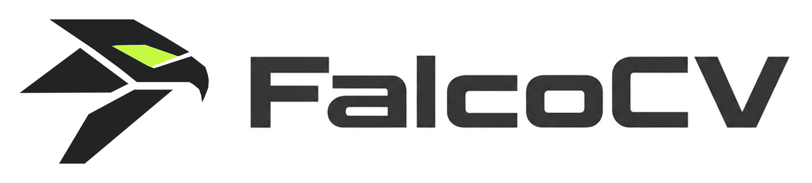

# FalcoCV — Industrial Machine Vision Framework

[](https://pypi.org/project/falcocv/)
[](https://pypi.org/project/falcocv/)
[](https://www.riverbankcomputing.com/software/pyqt/)
[](https://opencv.org/)
[](https://github.com/jaesc/falcocv/actions/workflows/ci.yml)

<picture>
  <source media="(prefers-color-scheme: dark)" srcset="src/falcocv/ui/assets/logo_lockup_dark.png">
  <source media="(prefers-color-scheme: light)" srcset="src/falcocv/ui/assets/logo_lockup_light.png">
  
</picture>

FalcoCV is a modular machine vision environment for industrial automation. It
combines a workflow-driven tool pipeline with real-time image processing,
inspection, depth/3D analysis and camera acquisition, plus a web-based HMI for
operator dashboards.

> FalcoCV is under active development: interfaces and job formats may change
> between releases.

## Highlights

- **Workflow engine** — connect tools in a directed graph; jobs are saved as
  `.cvj` files.
- **Vision toolset** — acquisition, image enhancement, segmentation, template
  and shape matching, code reading, measurement, deep-learning inspection and
  3D analysis.
- **Depth + 3D** — depth/range loading, point clouds, plane fitting and a 3D
  viewer with world-space overlays.
- **Fixture system** — per-image coordinate transforms; tools work in
  fixture-relative coordinates.
- **Vector overlays** — annotations are mathematical primitives rendered only
  by visible viewers; source pixels are never modified.
- **Scripting + debugger** — editor, breakpoints, stepping and variable/watch
  panels.
- **HMI designer + web server** — design operator dashboards, deploy them to a
  FastAPI server and open them from any browser.
- **Camera acquisition** — GigE Vision and USB3 Vision cameras through Harvesters
  and a vendor GenTL producer.

## Install

FalcoCV is distributed as a wheel for Windows x86_64 and Linux x86_64
(CPython 3.10–3.13):

```bash
python -m pip install falcocv
```

The native kernel ships inside the wheel, so no compiler is needed. On platforms
without a wheel, `pip` builds it from the sdist and needs Python 3.10+ (3.13
recommended), CMake 3.20+ and a C++17 compiler. On Linux the wheels target
glibc 2.34+ (Ubuntu 22.04+, Debian 12+, RHEL 9+), which is what PyQt6 requires.
GigE and USB3 Vision cameras only need the vendor GenTL producer (`.cti` file);
the Harvesters integration is installed by default.

### From source

```bash
git clone https://github.com/jaesc/falcocv.git
cd falcocv
python -m pip install ".[dev]"
```

### Models

ONNX models are not bundled with the package; they are downloaded on first use
to:

- Windows: `%APPDATA%/FalcoCV/models`
- Linux: `$XDG_DATA_HOME/FalcoCV/models` (or `~/.local/share/FalcoCV/models`)

The splash screen shows progress and startup waits until the models are ready.
To pre-download or repair them:

```bash
falcocv download-models
# or the dedicated entry point
falcocv-download-models
```

To use an existing local bundle instead (offline or pre-provisioned machines),
point `FALCOCV_MODELS_DIR` at the folder that contains the model files.

Downloads come from a GitHub Release. Override the base URL to use a mirror:

```bash
export FALCOCV_MODELS_URL="https://mirror.example.com/falcocv/models-v1"
```

## Run

| Command | What runs |
|---------|-----------|
| `falcocv` or `python -m falcocv` | Vision Editor (desktop) |
| `falcocv-server` | Web server / dashboard |
| `falcocv-hmi` | Standalone HMI Designer |
| `falcocv download-models` | Download/verify ONNX models |

The web dashboard is served at `http://localhost:8000`; HMI pages are available
at `http://localhost:8000/?id=<project_id>`.

## Architecture

```
src/falcocv/
├── core/        Workflow engine, VisionImage, overlays, ROI, model resolver
├── tools/       Vision tools
├── ui/          PyQt6 widgets, viewers, ROI editors, HMI designer
├── web/         FastAPI server, HMI workers, dashboard
├── main.py      Vision Editor
├── cli.py       `falcocv` / `python -m falcocv`
└── version.py

cpp/kernel/      Native kernel (no OpenCV)
tests/           Pytest suite
```

FalcoCV is Python-first: tools and algorithms use OpenCV/NumPy unless a measured
benchmark justifies native code. The small C++ kernel in `cpp/kernel`
accelerates the hot paths where that win exists (for example point-cloud
generation, plane fitting and template matching). It has no OpenCV dependency;
OpenCV is provided by `opencv-python`.

See [`ARCHITECTURE.md`](ARCHITECTURE.md) for the module layout and
[`benchmarks/`](benchmarks/) for the performance harness.

## Development

```bash
git clone https://github.com/jaesc/falcocv.git
cd falcocv
python -m pip install -e ".[dev]"
pytest -q --ignore=tests/test_trainer_equivalence.py
```

An editable install builds the native kernel through `scikit-build-core`. To run
directly from the source tree, build the kernel once and point `PYTHONPATH` at
`src`:

```bash
build_kernel.bat          # Windows
./build_kernel.sh         # Linux/macOS

set PYTHONPATH=src        # Windows
export PYTHONPATH=src     # Linux/macOS
python -m falcocv
```

### Native kernel

```bat
build_kernel.bat            :: configure + build + deploy to cpp/bin
build_kernel.bat --rebuild  :: clean cache first
build_kernel.bat --clean    :: remove artifacts
```

```bash
./build_kernel.sh
```

Requirements: CMake 3.20+, a C++17 compiler, pybind11 and OpenMP. On Windows,
Visual Studio 2022 with the "Desktop development with C++" workload is enough.
No OpenCV build is required.

## Testing

```bash
pytest -q --ignore=tests/test_trainer_equivalence.py
```

Targeted runs:

```bash
pytest -q -m integration   # headless workflows, jobs, barcode, depth
pytest -q -m ui            # offscreen Qt config dialogs / main window
pytest -q -m web           # FastAPI / HMI endpoints
falcocv self-test          # installation smoke test (also works from a wheel)
```

The suite covers the workflow engine, vision tools, UI (offscreen Qt) and
web/HMI endpoints. The trainer-equivalence test needs the optional training
toolchain (torch/timm) and is excluded.

## License

FalcoCV is free software: you can redistribute it and/or modify it under the
terms of the GNU General Public License as published by the Free Software
Foundation, either version 3 of the License, or (at your option) any later
version.

FalcoCV is distributed in the hope that it will be useful, but WITHOUT ANY
WARRANTY; without even the implied warranty of MERCHANTABILITY or FITNESS FOR A
PARTICULAR PURPOSE. See [`LICENSE`](LICENSE) for the full text.
