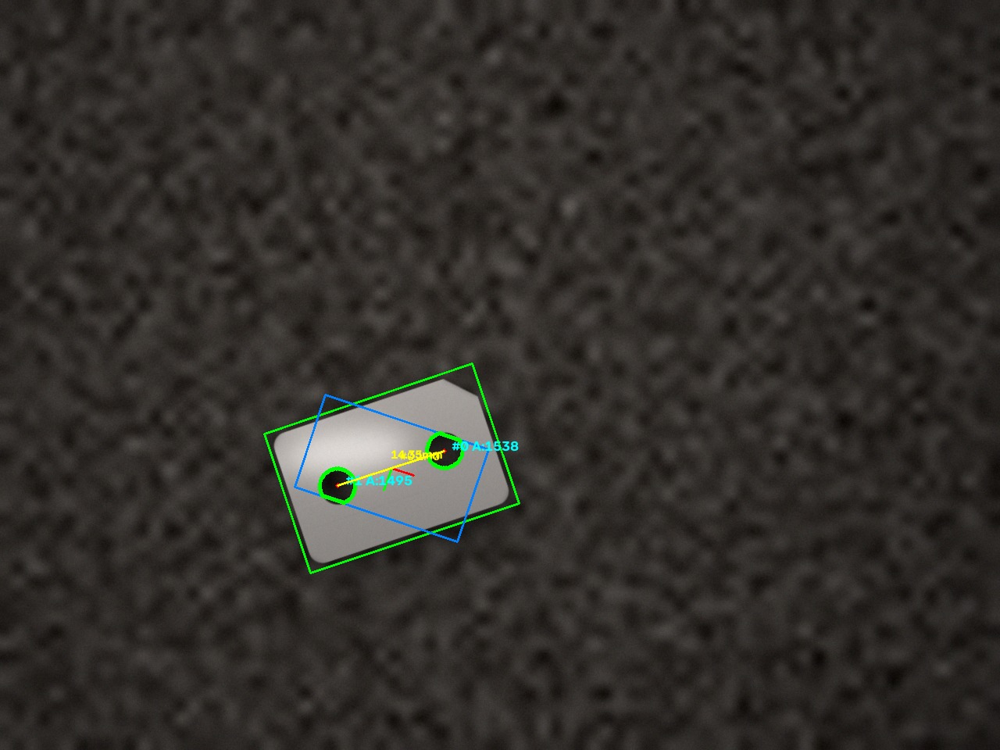
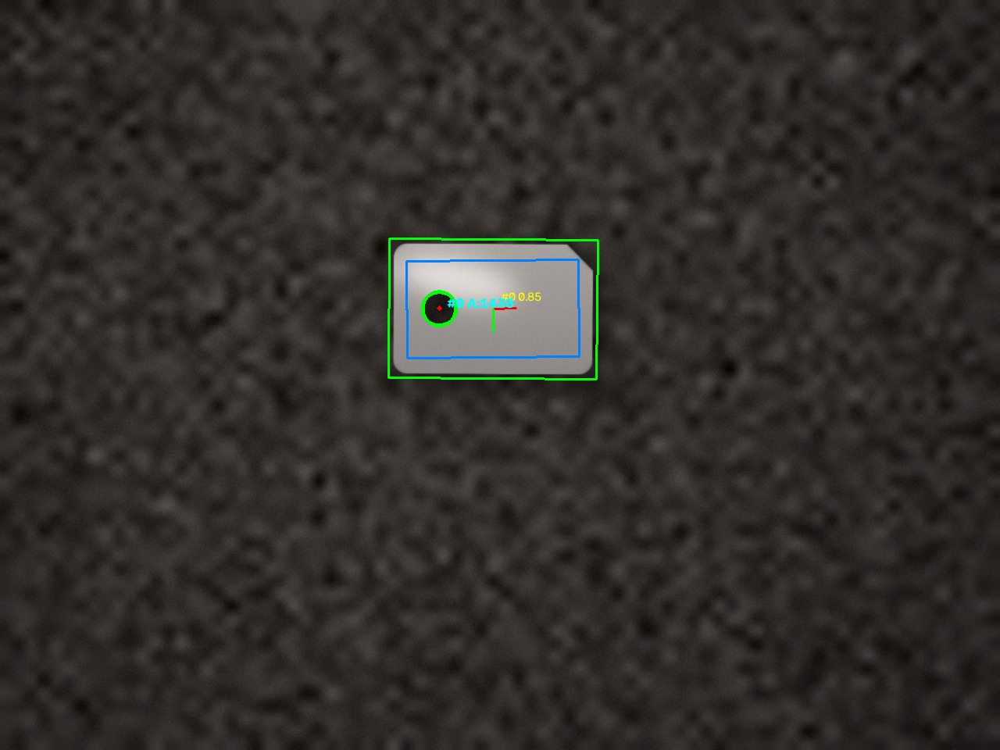

# Demo job — synthetic inspection dataset

`demo_inspection.cvj` is a small end-to-end pipeline:

```
Image Loader -> Shape Match (fixture) -> Blob Detector (holes) -> Measurement
```

- **Shape Match** locates the bracket and acts as the fixture.
- **Blob Detector** finds the through-holes in a fixture-relative ROI, so the
  ROI follows the part's rotation and position.
- **Measurement** reports the distance between the two hole centroids
  (10 px/mm).

The verdict rule used by the dataset: **OK** when exactly two holes are found
and the hole distance is within 12.5–15.5 mm; cosmetic marks (scratches, small
stains) are ignored.

## Run it

The job uses the relative path `examples/images`, so run it from the repository
root:

```bash
falcocv run examples/demo_inspection.cvj --output results.json
```

`falcocv run` processes one frame (the first image of the folder). Open the job
in the editor (`falcocv` → *File → Open job*) to step through all 14 images and
see the overlays.



Missing hole (NG):



## Dataset

`images/` contains 14 rendered scenes (1280x960) plus `manifest.json` with the
ground truth (centre, angle, scale, verdict, defect):

| Files | Verdict | Defect |
|---|---|---|
| `01_ok` … `08_ok` | OK | — |
| `09_ok_scratch`, `10_ok_stain` | OK | cosmetic only |
| `11_ng_missing_hole` | NG | one hole missing |
| `12_ng_blocked_hole` | NG | one hole filled with metal |
| `13_ng_extra_hole` | NG | third hole |
| `14_ng_holes_too_close` | NG | hole spacing 110 px instead of 140 px |

`train/part_reference.png` is the image used to train Shape Match.

## Regenerate everything

```bash
python examples/generate_demo_images.py   # images + manifest + reference
python examples/build_demo_job.py         # trains Shape Match and saves the .cvj
python examples/render_demo_result.py     # result_ok.jpg / result_ng.jpg
```

The generators are deterministic (fixed seeds), so the dataset can be rebuilt
byte-for-byte.

## Licence

The images, the reference and the annotated results are **original synthetic
renders** produced by these scripts with NumPy/OpenCV. No third-party photos,
textures or models are used. They are released under **CC0-1.0**, so they can be
used, modified and redistributed without attribution.

The demo is a synthetic scene for documentation; it is not a benchmark.
